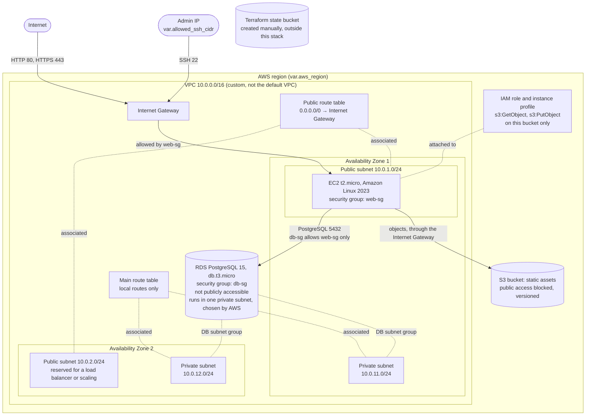

# Vela Payments infrastructure

Terraform code that rebuilds Vela Payments' AWS infrastructure from scratch: a custom VPC, an EC2 web server, a private RDS PostgreSQL database and a private S3 bucket for static assets.

## Quick start

## Architecture

The full diagram notes are in [docs/architecture.md](./docs/architecture.md).

## Setup

## Variables

## Design decisions

## Security notes

## Cost
