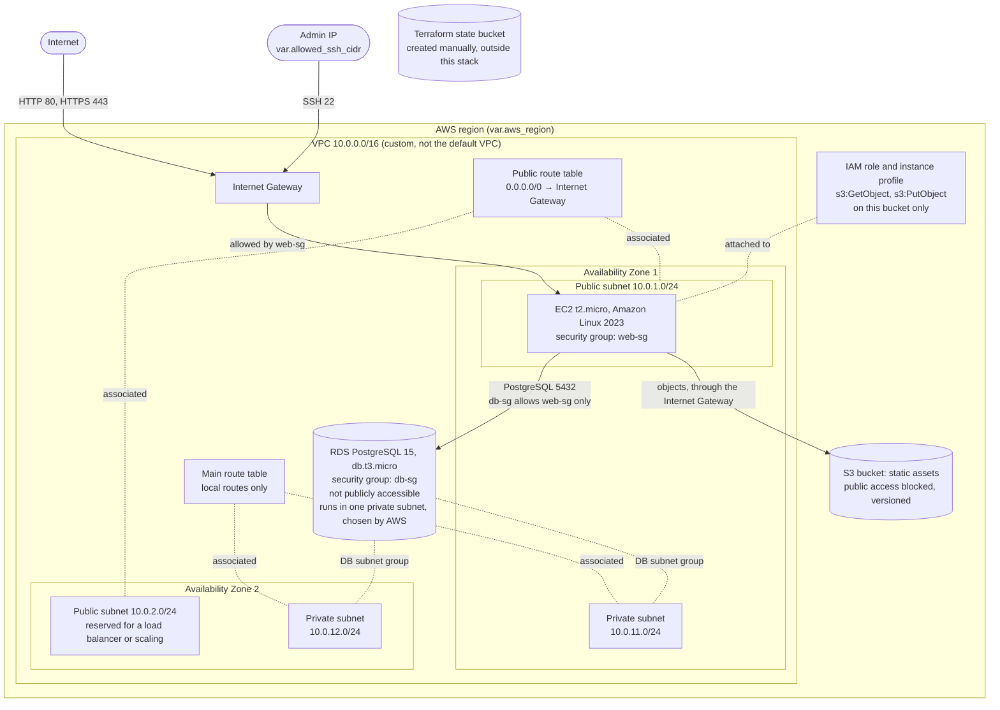

# Vela Payments infrastructure

Terraform code for Vela Payments' AWS infrastructure: a custom VPC, an EC2 web server, a private RDS PostgreSQL database and a private S3 bucket for static assets.

## Architecture



## Setup

Prerequisites: Terraform 1.5.7 or later (below 2.0) and AWS CLI v2.

### AWS credentials

Terraform uses the standard AWS credential sources (`aws configure`, `AWS_PROFILE` or environment variables); no credentials are in the code. Check them with `aws sts get-caller-identity`.

### State bucket

The S3 backend bucket must exist before `terraform init`. State stores the database password in plain text, so the bucket is private, versioned and encrypted. Create it once by hand:

```sh
BUCKET=your-terraform-state-bucket

aws s3api create-bucket --bucket "$BUCKET" --region us-east-1
aws s3api put-bucket-versioning --bucket "$BUCKET" \
  --versioning-configuration Status=Enabled
aws s3api put-public-access-block --bucket "$BUCKET" \
  --public-access-block-configuration BlockPublicAcls=true,IgnorePublicAcls=true,BlockPublicPolicy=true,RestrictPublicBuckets=true
aws s3api put-bucket-encryption --bucket "$BUCKET" \
  --server-side-encryption-configuration '{"Rules":[{"ApplyServerSideEncryptionByDefault":{"SSEAlgorithm":"AES256"}}]}'
```

### Init and plan

```sh
cd infra
cp backend.hcl.example backend.hcl     # set bucket to your state bucket
terraform init -backend-config=backend.hcl
terraform plan -var-file=../example.tfvars
```

`example.tfvars` holds placeholder values that are enough for `plan`. To apply, copy it to `dev.tfvars`, set your own values and run `terraform apply -var-file=../dev.tfvars`. To log in to the web server afterwards, connect from the IP in `allowed_ssh_cidr` with EC2 Instance Connect: `aws ec2-instance-connect ssh --instance-id <id> --os-user ec2-user` (the ID is shown by `terraform state show aws_instance.web`).

## Tear down

```sh
terraform destroy -var-file=../dev.tfvars
```

Empty the versioned assets bucket first (S3 console: **Empty**), or `destroy` fails on it.

## Variables

| Name | Type | Default | Description | Sensitive |
| --- | --- | --- | --- | --- |
| `aws_region` | string | none (required) | AWS region to deploy all resources into. | No |
| `vpc_cidr` | string | `10.0.0.0/16` | CIDR block for the VPC. | No |
| `public_subnet_a_cidr` | string | `10.0.1.0/24` | First public subnet, in the first Availability Zone. | No |
| `public_subnet_b_cidr` | string | `10.0.2.0/24` | Second public subnet, in the second Availability Zone. | No |
| `private_subnet_a_cidr` | string | `10.0.11.0/24` | First private subnet (database), in the first Availability Zone. | No |
| `private_subnet_b_cidr` | string | `10.0.12.0/24` | Second private subnet (database), in the second Availability Zone. | No |
| `allowed_ssh_cidr` | string | none (required) | Your IP in CIDR notation, the only source allowed to SSH into the web server. `0.0.0.0/0` is rejected. | No |
| `db_username` | string | none (required) | Master username for the PostgreSQL database. | Yes |
| `db_password` | string | none (required) | Master password for the PostgreSQL database. | Yes |
| `s3_bucket_name` | string | none (required) | Globally unique name for the static assets bucket. | No |

## Design decisions

- **Private subnets on the VPC's main route table.** Only the two public subnets are associated with the public route table. The private subnets fall back to the main route table, which holds only the local route for `10.0.0.0/16`, so the database can reach the web server inside the VPC and nothing outside it.
- **Availability Zones and the AMI are looked up, not hardcoded.** An `aws_availability_zones` data source picks the region's first two available zones, and an `aws_ami` data source picks the newest Amazon-owned Amazon Linux 2023 x86_64 image. Zone names and AMI IDs differ per region, so the same code plans in whichever region `aws_region` names.
- **Partial backend configuration.** Backend blocks can't read variables, and every reviewer has a different state bucket, so the bucket name comes from `backend.hcl` at init instead of being hardcoded.
- **SSH through EC2 Instance Connect.** No key pair is attached to the web server. Each login pushes a one-time public key that IAM must authorize and that expires after 60 seconds, and `web-sg` accepts port 22 only from `allowed_ssh_cidr`, so no long-lived SSH key exists to leak.