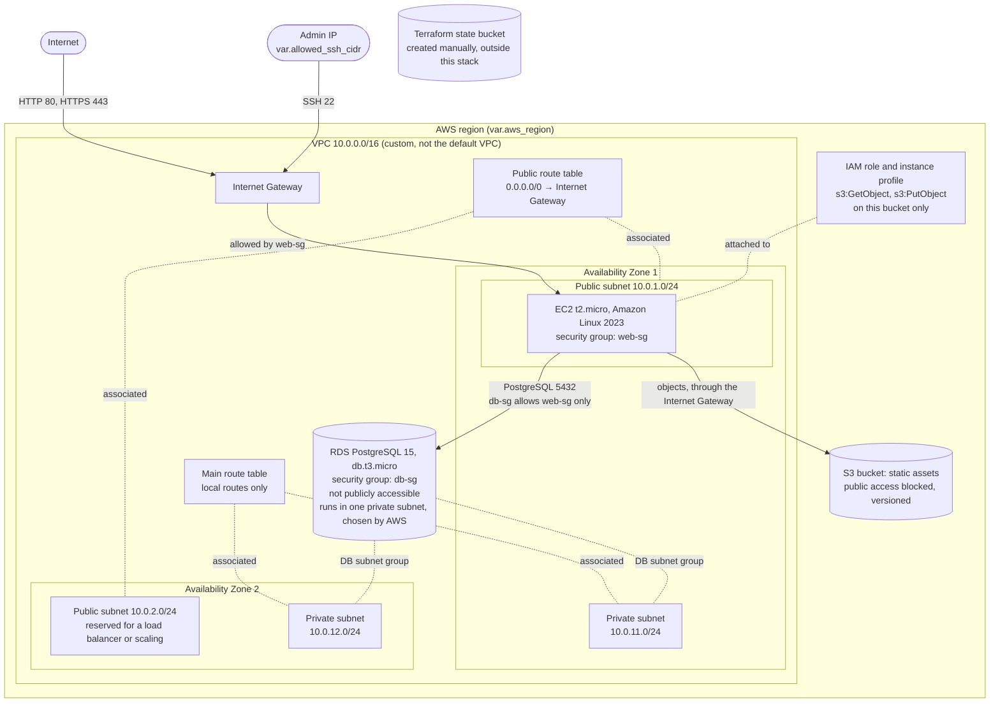

# Architecture

Vela Payments runs a two-tier web application in a custom VPC: a public web server and a private PostgreSQL database, with a private S3 bucket for static assets. The layout follows the brief exactly; where the brief leaves a choice open, the decision is recorded in [`adr/`](./adr/) and marked in the table below.

## How to read it

| Element | What the diagram shows | Source |
| --- | --- | --- |
| VPC | `10.0.0.0/16`, custom; every VPC resource lives in it | Brief, Part 1 |
| Subnets | Two public and two private, one of each per Availability Zone | Brief, Part 1 |
| Subnet CIDRs | `10.0.1.0/24`, `10.0.2.0/24` public; `10.0.11.0/24`, `10.0.12.0/24` private | Decision, ADR 0005 |
| Internet Gateway and public route table | `0.0.0.0/0` to the gateway, associated with the public subnets only | Brief, Part 1 |
| Private subnets | Keep the VPC's main route table, so they have local routes only and no internet path; no NAT Gateway | Decision, ADR 0005 |
| Second public subnet | Unused by v1. Required by the brief; ready for a load balancer or scaling group, which need two Availability Zones | Brief, Part 1 |
| Second private subnet | Required by RDS: a DB subnet group must span at least two Availability Zones, even for a single-AZ database | Brief, Part 1, and AWS |
| `web-sg` inbound | 80 and 443 from `0.0.0.0/0`; 22 from `var.allowed_ssh_cidr` only | Brief, Part 2 |
| `web-sg` outbound | All traffic, declared explicitly because Terraform removes the AWS default rule | Brief, Part 2; ADR 0006 |
| EC2 instance | `t2.micro`, Amazon Linux 2023, in a public subnet (the first one) | Brief, Part 2; placement ADR 0007 |
| EC2 hardening | IMDSv2 required, encrypted root volume | Decision, ADR 0007 |
| IAM | Instance profile; only `s3:GetObject` and `s3:PutObject` on this bucket's objects | Brief, Part 2 |
| `db-sg` inbound | 5432 from `web-sg` only, by security group reference, never by CIDR | Brief, Part 3 |
| RDS | PostgreSQL 15 on `db.t3.micro`, private subnets, not publicly accessible | Brief, Part 3 |
| RDS placement | Single-AZ; AWS picks which private subnet | Decision, ADR 0008 |
| RDS storage | Encrypted, 20 GB, no final snapshot on destroy | Decision, ADR 0008 |
| S3 bucket | Public access blocked, versioning enabled, name from a variable | Brief, Part 4 |
| S3 access | Reachable through the EC2 role's policy; public access blocked. A bucket policy denying every other principal is the stricter option, not applied because it can lock out administrators | Brief, Part 4; open decision, ADR 0009 |
| S3 encryption | SSE-S3, so the IAM role needs no KMS permissions | Decision, ADR 0009 |
| EC2 to S3 path | Public S3 endpoint through the Internet Gateway | Decision, ADR 0005 (a gateway endpoint is the listed alternative) |
| State bucket | S3 backend, created by hand before `terraform init` | Brief, Part 5; ADR 0004 |
| Tags | `Project = "vela-payments"` on every resource, through the provider's `default_tags` | Brief, Part 1 |

**Notes on the drawing:**

- **Route tables and the DB subnet group sit at VPC level,** linked to the subnets they apply to. They are configuration attached to subnets, not resources inside one.
- **Security groups are shown as labels,** not boxes around resources. They attach to the instance's and database's network interfaces rather than forming a network boundary, which is why `db-sg` can trust `web-sg` regardless of which subnet either resource is in.
